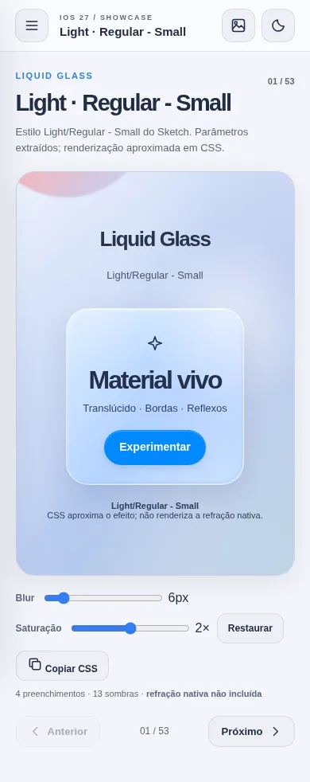
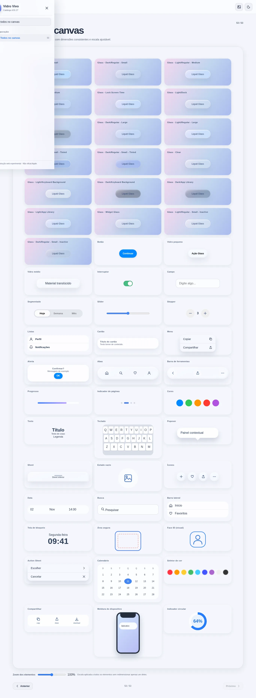

# iOS 27 UI Demo

PWA experimental para testar visualmente **componentes web inspirados** no Apple iOS 27 UI Kit enviado pelo usuário. Uma tela por elemento/família, menu lateral recolhido e, por último, uma composição de todas as famílias em um canvas comparativo.

**IMPORTANTE:** reconstrução própria em HTML/CSS/JavaScript, **não** kit ou interface oficial da Apple. A refração física e o shader nativo do Liquid Glass não são reproduzidos pelo CSS.





## O que contém

- 19 rotas de Glass individuais + rotas de controles, conteúdo, navegação, seletores, sistema, etc.
- **53 telas**: 19 Liquid Glass + 33 grupos de componentes + último canvas com **54 exemplos**.
- Menu lateral oculto com busca e grupos; tela ampla, próximo/anterior, links por hash e swipe lateral.
- Testes de componentes funcionais (botões, segmentado, switch, stepper, menu, diálogo, sheet, seletores, teclado virtual demonstrativo, busca, calendário, compartilhamento quando suportado).
- Controles de modo claro/escuro, fundo contrastante e neutro, blur/saturação de cada variante.
- **Última página: “Todos no canvas”**, exemplos lado a lado, com tamanhos CSS comparáveis e controle de escala.
- Reutiliza **107 cores e 105 estilos tipográficos** extraídos do Sketch anterior, com galeria pesquisável e JSON/CSV para consulta.
- Offline após primeiro acesso via HTTPS; manifest e service worker; sem dependências.
- CSS reutilizável: `css/tokens.css`, `css/typography.css`, `css/glass.css`, `css/ui-library.css`; CSS exclusivo do mostruário: `css/showcase.css`.

## Publicação — GitHub Pages

Repositório: https://github.com/viniciusnevesdev/iOS-27-UI-Demo

PWA: https://viniciusnevesdev.github.io/iOS-27-UI-Demo/

Publicação pela branch `main`, pasta `/(root)`, via GitHub Pages. Arquivo de entrada: `index.html`.
Para instalar no Safari do iPhone: Compartilhar → Adicionar à Tela de Início.

### Teste local

```bash
python3 -m http.server 8000
```

Abra `http://localhost:8000`.

## Organização

- `index.html`: estrutura do PWA e ícones SVG originais simplificados.
- `js/type-data.js`: dados tipográficos para os 105 estilos exibidos.
- `docs/`: capturas de tela do mostruário, geradas em navegador de testes.
- `js/showcase.js`: rotas, demonstrações e interações.
- `css/showcase.css`: aparência da navegação e do laboratório.
- `css/glass.css`, `css/ui-library.css`: biblioteca reutilizável anterior.
- `data/`: inventário do Sketch, 19 variantes, estilos, paletas.
- `assets/`: ícones do PWA, criados para este exemplo.
- `tools/`: scripts anteriores de extração e validação.

## Segurança, compatibilidade, limites

- Não inclui fontes, imagens ou outras peças proprietárias do Sketch. Ícones da demonstração são símbolos SVG simplificados, próprios e não uma cópia do SF Symbols.
- A página de Face ID é visual: **não** acessa câmera nem identifica rostos.
- A tela de bloqueio é ilustrativa, não réplica exata de um dispositivo.
- Recurso Web Share varia conforme o navegador.
- Sem coleta de dados e sem requisições a terceiros.
- As medidas do canvas são CSS pixels e comparam elementos relativos ao próprio mostruário; não garantem equivalência às dimensões nativas.
- Não modificar nem sobrescrever deploys de outros PWAs: publique em um projeto Cloudflare novo.

## Testes realizados

- Sintaxe de JavaScript, estrutura HTML, JSON, CSS importável, presença das imagens/ícones do manifest.
- Em Chromium headless com HTML e recursos locais injetados: 53 telas percorridas sem erros JavaScript e sem transbordamento horizontal nas larguras 320, 390, 768 e 1366 px.
- Interações testadas: menu/busca, navegação, segmentado, stepper, diálogo, sheet e seleção Glass.
- **Pendente:** teste em Safari real, instalação/offline após deploy HTTPS e verificação da publicação.
